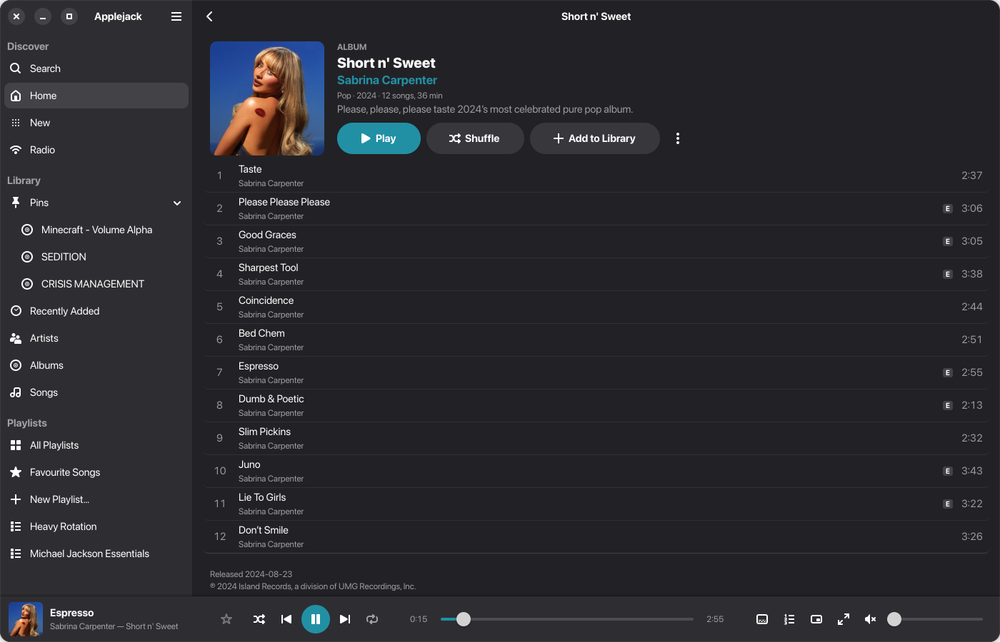
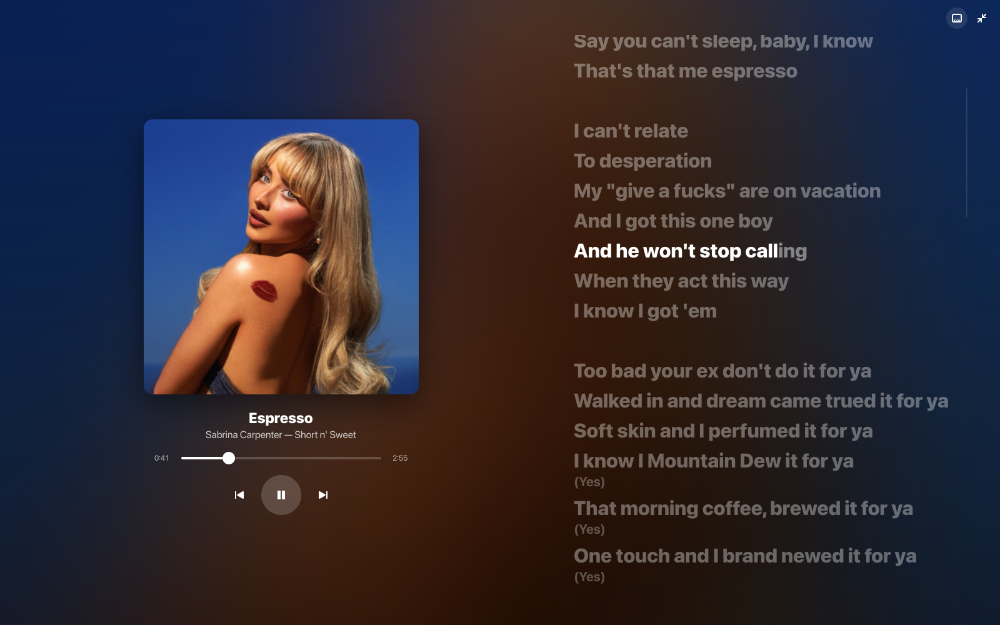
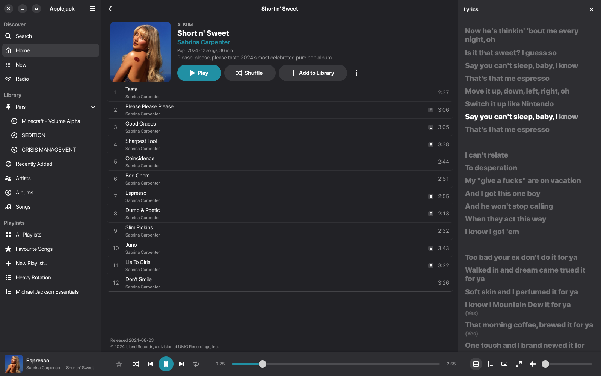
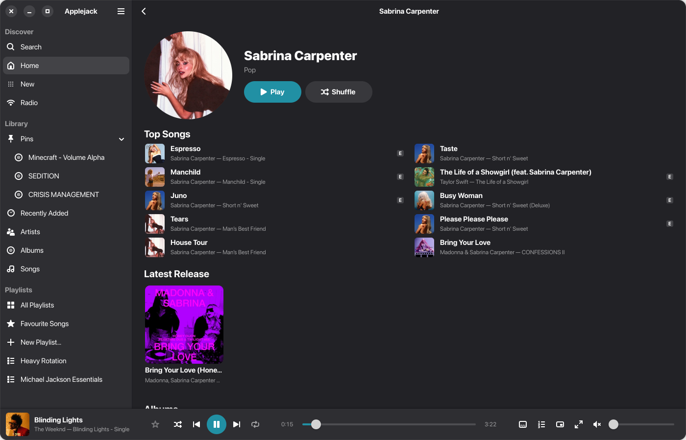
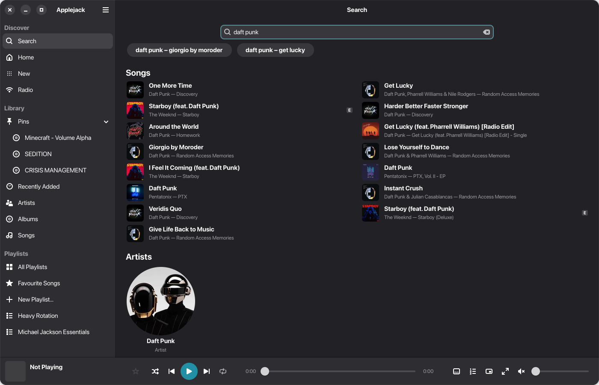
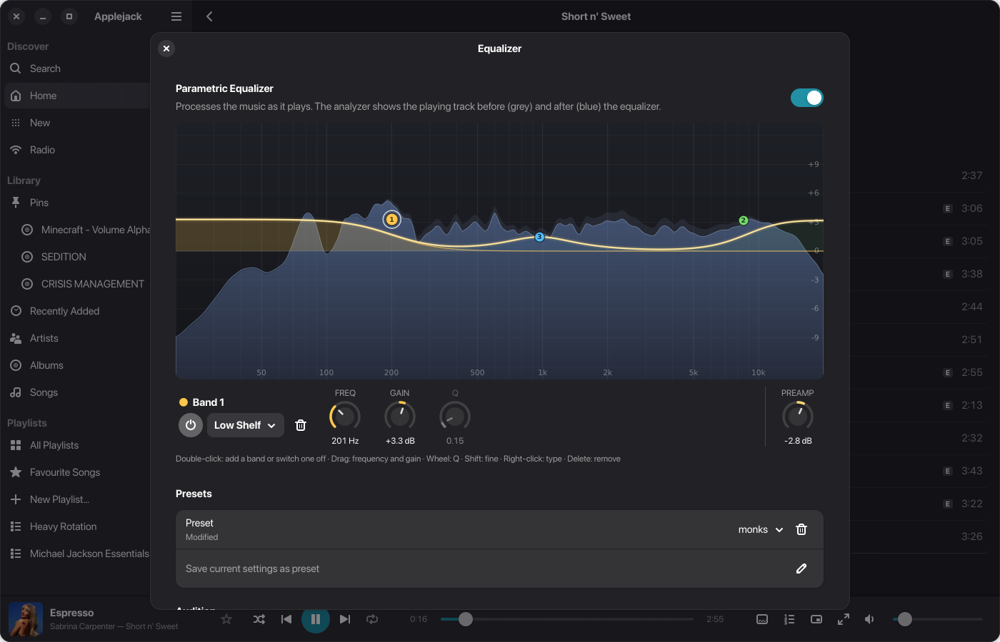
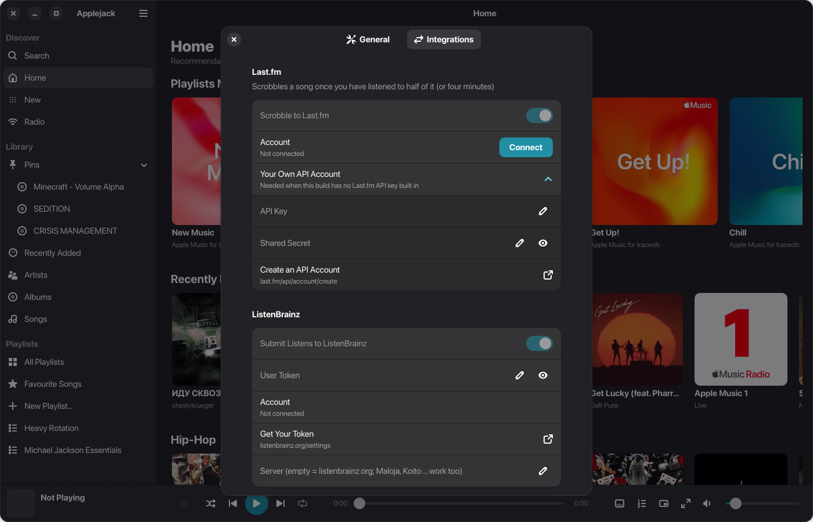
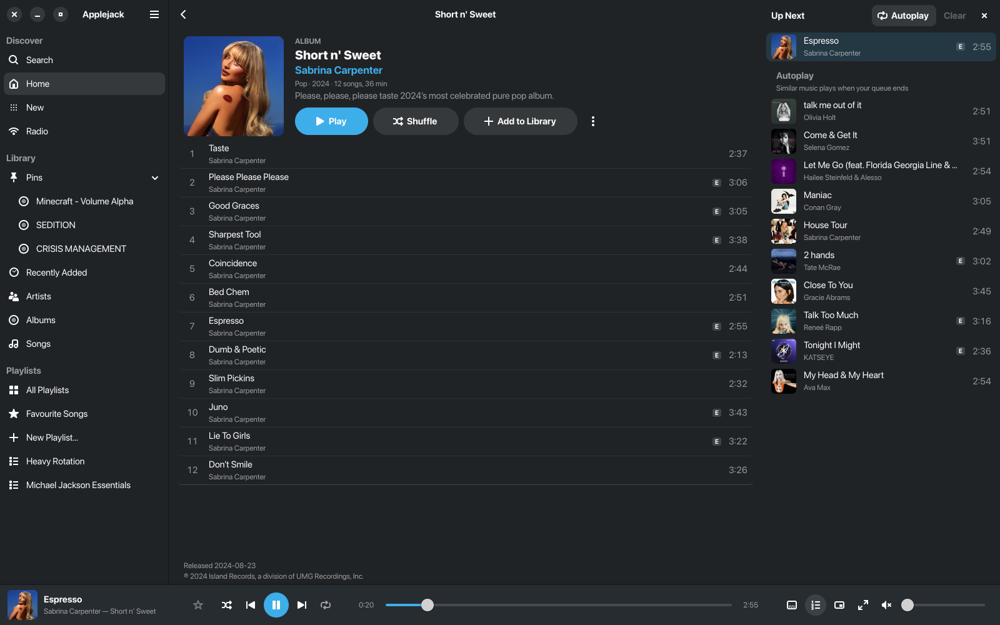

<p align="center"></p>

<h1 align="center">Applejack</h1>

<p align="center">A native music streaming player for the Linux desktop (GTK4 + libadwaita).<br>
A free alternative to Cider.</p>

<p align="center">
  <a href="https://github.com/traceofc/applejack/releases/latest"></a>
  <a href="LICENSE"></a>
  
  
  
</p>

<p align="center">
  <a href="#install">Install</a> ·
  <a href="#what-it-can-do">Features</a> ·
  <a href="#screenshots">Screenshots</a> ·
  <a href="#scrobbling-and-discord">Scrobbling &amp; Discord</a> ·
  <a href="#disclaimer">Disclaimer</a>
</p>

<p align="center"></p>

Applejack looks and feels like a native desktop app and plays your streaming library through the
official web player at music.apple.com: your library, playlists, radio, lyrics and
recommendations. You need your own subscription to that service.

> **As is, no support.** Applejack is a personal project shared for free. Bugs are not fixed on
> request, issues and feature requests may go unanswered, and there are no updates promised. You use
> it entirely at your own risk and responsibility. The code is free software: fork it, change it,
> ship it, as long as your version stays open source under the same license (GPL-3.0-or-later).

## Screenshots

| | |
|---|---|
|  |  |
|  |  |
|  |  |
|  |  |

## Install

Open a terminal and paste this line:

```bash
curl -fsSL https://raw.githubusercontent.com/traceofc/applejack/main/get.sh | bash
```

That's it. Applejack appears in your app menu. Open it, press **Sign In** and log in with
your Apple ID. You only have to do that once.

No sudo needed: everything goes into your home folder (`~/.local`). If the installer says
some libraries are missing, it prints the exact command for your distro. Run that command,
then paste the line above again.

**Offline installer:** `scripts/make-installer.sh` builds a single file,
`Applejack-<version>-x86_64.run`. Copy it anywhere and run `./Applejack-0.1.0-x86_64.run`
(`--uninstall` removes it again).

**Works on:** Arch, Manjaro, Fedora 41+, Ubuntu 25.04+, Debian 13, openSUSE Tumbleweed and
other up-to-date x86_64 distros (GTK 4.14+ and libadwaita 1.6+).

**Update:** run the same line again.

**Uninstall:**

```bash
~/.local/lib/applejack/uninstall.sh
```

Add `--purge` to also forget your sign-in and cached library.

## What it can do

- Home (recommendations, recently played), Browse (charts), Radio (live and stations), Search.
- Your library: recently added, artists, albums, songs, and your playlists in the sidebar.
- Artist pages with top songs, albums, singles, playlists, similar artists and a bio.
- Play, shuffle, add to library, play next or later, love or "suggest less" from a right-click menu.
- Synced lyrics, word by word where available (click a line to jump there), and the play queue.
- Full-screen player with a blurred cover backdrop and big lyrics; a mini player that stays on
  top (KDE Plasma, Hyprland, Sway, X11; on GNOME use Alt+Space → Always on Top).
- Playlists: create, add songs or albums, rename, reorder by dragging, remove tracks, delete.
- Scrobbling to Last.fm and ListenBrainz (or Maloja / Koito); listens made offline are sent later.
- Discord status ("Listening to …"), also with Vesktop / arRPC.
- 10-band parametric equalizer with a live spectrum.
- Works on GNOME and KDE Plasma: follows the system's light / dark style and accent colour, and can
  take its colours from the Plasma colour scheme.
- Lives on the desktop: tray icon with a player menu (on GNOME with the AppIndicator extension),
  media keys and the system media controls (MPRIS), track notifications, playing on with the
  window closed, launch at login, no sleep while music plays. See Preferences (Ctrl+,).

| Keys | Action |
|---|---|
| Ctrl+Space | play / pause |
| Ctrl+← / Ctrl+→ | previous / next track |
| Ctrl+F | search |
| Ctrl+L | lyrics |
| Ctrl+U | queue |
| Ctrl+R, F5 | refresh |
| Ctrl+, | preferences |
| Ctrl+E | equalizer |
| F11 | full-screen player |
| Ctrl+Shift+M | mini player |
| Ctrl+N | new playlist |
| Alt+← | back |

## Scrobbling and Discord

Preferences → Integrations. Last.fm needs an API account (free, last.fm/api/account/create) unless
the build has one built in; ListenBrainz needs your user token; Discord needs an application id
(create an application named "Applejack" at discord.com/developers). Release builds take
`APPLEJACK_LASTFM_KEY`, `APPLEJACK_LASTFM_SECRET` and `APPLEJACK_DISCORD_CLIENT_ID` from the
repository's Actions secrets, so users don't have to.

## Troubleshooting

- **Nothing plays after signing in.** Use the menu (☰) → *Restart Engine*. The engine log is
  in `~/.cache/applejack/engine.log`.
- **Ubuntu: the engine crashes with a "sandbox" error.** Ubuntu blocks the browser sandbox
  for apps outside its store. Fix it once with:
  `sudo chown root:root ~/.local/lib/applejack/electron/chrome-sandbox && sudo chmod 4755 ~/.local/lib/applejack/electron/chrome-sandbox`
- **Start over with sign-in.** Close Applejack and delete `~/.config/applejack`.

## How it works

The window is a Rust + GTK4/libadwaita app. Playback runs in a hidden helper process
(`applejack-engine`): [castLabs Electron](https://github.com/castlabs/electron-releases), a
build of Electron that includes the Widevine DRM module the service needs, showing its own
web player at music.apple.com. The window talks to it over a small JSON protocol. Details are
in [docs/ENGINE.md](docs/ENGINE.md).

| Where | What |
|---|---|
| `~/.local/lib/applejack/` | the app, the engine and Electron |
| `~/.local/bin/applejack` | command to start it from a terminal |
| `~/.config/applejack/` | your sign-in (browser profile of the engine) |
| `~/.cache/applejack/` | library cache, artwork, engine log |

## Build from source

```bash
git clone https://github.com/traceofc/applejack.git
cd applejack
./install.sh
```

`install.sh` checks the build tools (on Arch it installs them with pacman, elsewhere it tells
you what to install), downloads castLabs Electron, builds a release bundle with
`scripts/package.sh` and installs it the same way as the one-line installer.
For development: `cd ui && cargo run --release`.

Releases are built by GitHub Actions (`.github/workflows/release.yml`) when a `v*` tag is
pushed: `git tag v0.1.0 && git push --tags`.

Project layout: `ui/` the GTK client, `engine/` the playback engine, `cli.js` a terminal client
for debugging the engine, `data/` icons and the desktop file, `scripts/` setup, packaging and
icon generation, `packaging/` files that go into the release bundle.

## License

Applejack is free software, licensed under the GNU General Public License, version 3 or (at your
option) any later version (GPL-3.0-or-later, see [LICENSE](LICENSE)). If you distribute Applejack
or a modified version, you must make its source available under the same license. Releases up to
and including v0.1.1 were published under the MIT license and stay available under it.

The release bundle also contains
castLabs Electron (MIT, with Chromium's licenses) and Rust crates under MIT, Apache-2.0
and similar licenses; their texts ship in the bundle's `licenses/` folder. The Widevine module
is downloaded by Electron at first start and is not part of this project.

Applejack is an unofficial project. It is not affiliated with, endorsed or sponsored by
Apple Inc. or by the makers of Cider. All trademarks belong to their owners. You need your own
subscription.

## Disclaimer

The software is provided "as is", without warranty of any kind (see [LICENSE](LICENSE)). The
author does not fix bugs, answer support requests or guarantee that Applejack keeps working:
the streaming service can change its web player at any time. Everything you do with Applejack,
including how you use your account with it, is at your own risk and responsibility. You are free
to use, change and share the code under the terms of the GPL.
